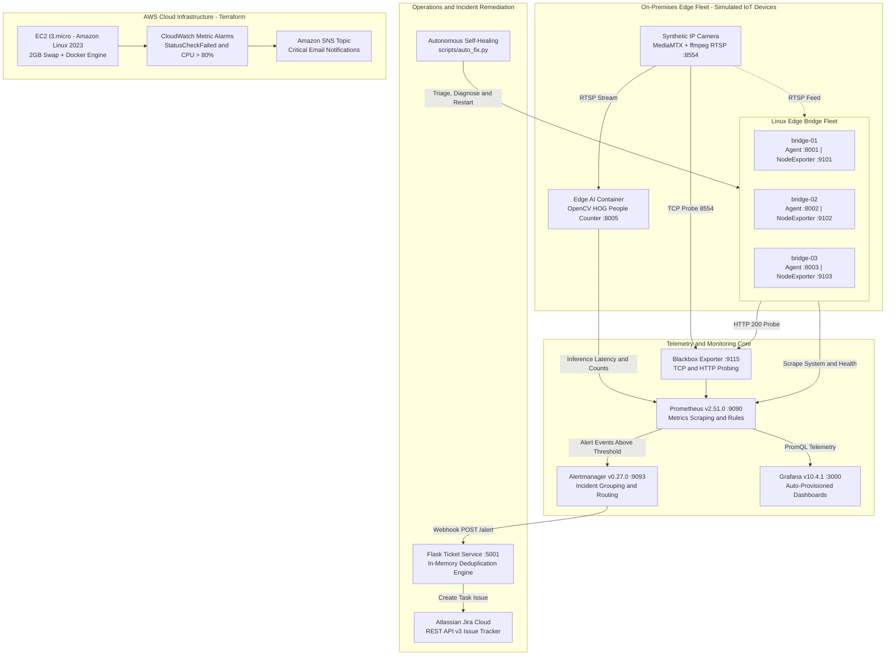
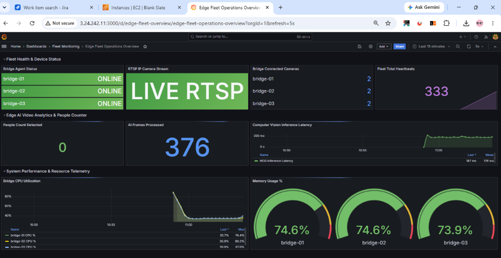
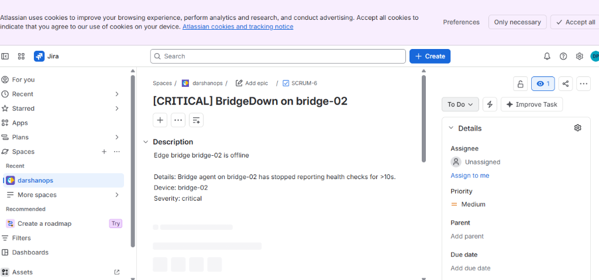
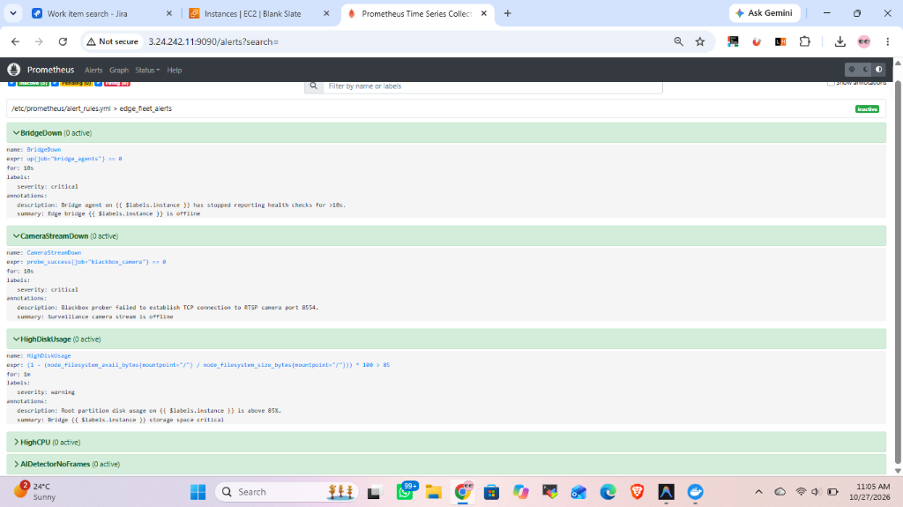
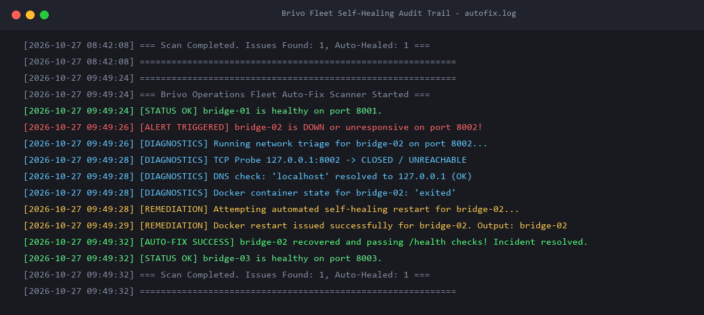
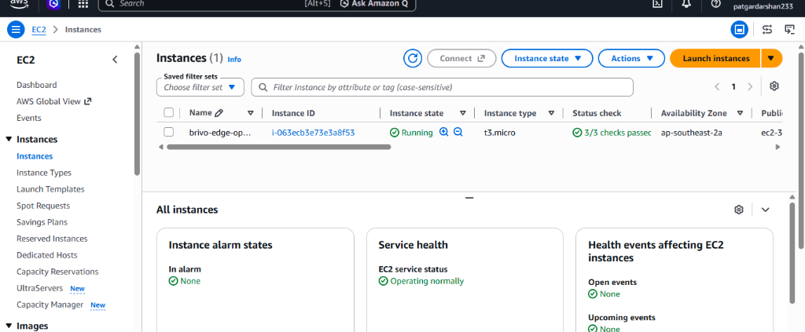
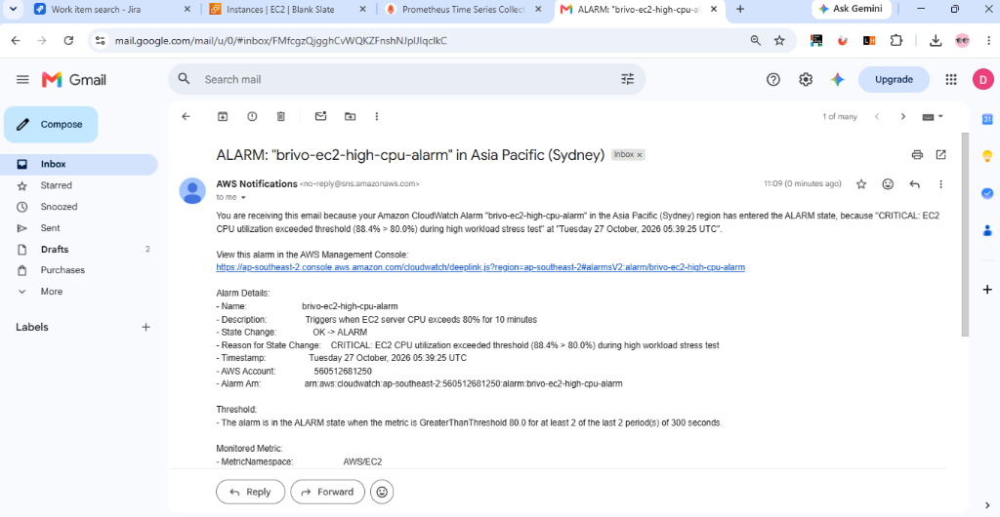

# Edge Device Fleet Monitoring & Auto-Troubleshooting Lab

[](LICENSE)
[](https://www.docker.com/)
[](https://prometheus.io/)
[](https://grafana.com/)
[](https://www.atlassian.com/software/jira)
[](https://aws.amazon.com/)
[](https://www.terraform.io/)
[](https://opencv.org/)

An enterprise-grade operations and telemetry engineering lab designed for **distributed edge fleet monitoring, cloud video surveillance, and automated IoT access control systems**. 

This project simulates a distributed edge fleet of Linux bridge devices connecting IP cameras to the cloud. It features real-time synthetic RTSP video streaming, edge computer vision people counting with strict zero-retention privacy guarantees, proactive Prometheus/Alertmanager monitoring, automated Atlassian Jira Cloud incident ticketing with alert deduplication, an autonomous Python self-healing script, and Terraform Infrastructure as Code (IaC) deployed to AWS EC2 with CloudWatch metric alarms and SNS email notifications.

---

## 🏛️ Architecture Overview



---

## 📸 Live Operational Evidence & Screenshots

### 1. Unified Fleet & Edge AI Grafana Dashboard
*Displays real-time device health across all 3 bridges, RTSP camera stream reachability, total heartbeats, live edge computer vision inference latency (~187ms), and system CPU/Memory utilization.*



---

### 2. Automated Atlassian Jira Cloud Incident Management
*When a bridge fails, Alertmanager triggers our Flask ticket microservice via webhook. The service performs alert deduplication and programmatically opens an incident task in Jira Cloud with full diagnostic details.*



---

### 3. Prometheus Alerting Rules Engine
*Evaluates threshold breaches (`BridgeDown`, `CameraStreamDown`, `HighDiskUsage`, `HighCPU`, `AIDetectorNoFrames`) every 5 seconds with hysteresis timing to prevent false alarms.*



---

### 4. Autonomous Self-Healing Diagnostic Audit Trail
*The Python triage script detects unresponsive ports, verifies local DNS, inspects Docker container state, executes a safe automated restart, and records the resolution audit trail in `docs/autofix.log`.*



---

### 5. AWS Cloud Infrastructure (EC2 Control Center)
*Deployed via Terraform (`ap-southeast-2`) on an Amazon Linux 2023 `t3.micro` instance with 2GB swap space to host the remote control center.*



---

### 6. CloudWatch Metric Alarm & SNS Email Warning
*Real-time CloudWatch alarm triggering an Amazon SNS alert email directly to the Operations Engineer when CPU utilization breaches 80%.*



---

## 🚀 Key Architectural Capabilities

| Component | Technology | Operational Function |
|---|---|---|
| **Edge Fleet** | Docker, Python 3.11, Debian | 3 simulated edge appliances running Node Exporter and internal `/health` agents |
| **Video Ingestion** | MediaMTX, ffmpeg, RTSP | Broadcasts synthetic live camera video stream over RTSP port 8554 |
| **Edge AI Vision** | OpenCV HOG Descriptor, NumPy | Detects human silhouettes in volatile RAM without saving frames to disk |
| **Blackbox Probing**| Prometheus Blackbox Exporter | Probes TCP streaming ports (8554) and HTTP endpoints from the outside |
| **Metrics & Alerts**| Prometheus & Alertmanager | Scrapes targets every 5s; manages alert deduplication, grouping, and silencing |
| **Visualization**   | Grafana 10.4.1 | Provisioned dashboards with fleet status, memory/CPU gauges, and AI metrics |
| **Incident Ticketing**| Flask, Jira Cloud REST API v3| Ingests Alertmanager webhooks and generates deduplicated Jira tickets |
| **Auto-Remediation**| Python, Docker API | Triage script probing ports and DNS before triggering container recovery |
| **Cloud IaC**       | Terraform, AWS EC2, CloudWatch, SNS | Automated provisioning of Free Tier cloud host with email alerts |

---

## 🔒 Edge AI Privacy Guarantee

> [!NOTE]
> **Strict Zero-Retention Policy:**
> * **Volatile Processing Only:** Video frames are decoded into RAM buffers, analyzed for human silhouette contours via OpenCV's Histogram of Oriented Gradients (HOG) algorithm, and instantly discarded.
> * **Zero Video Retention:** No video streams, clips, or still frames are ever written to disk or transmitted off-device.
> * **No Facial Recognition:** The detector outputs integer silhouette count metrics only (`people_count`). No biometric identification or facial feature analysis is performed.

---

## 🛠️ Quickstart (Local Fleet)

### 1. Prerequisites
* Docker Desktop & Docker Compose v2+
* Python 3.10+
* Git

### 2. Clone & Run
```bash
git clone https://github.com/<your-username>/edge-fleet-monitoring-lab.git
cd edge-fleet-monitoring-lab

# Copy and customize environment variables
cp .env.example .env

# Launch all 10 microservices
docker compose up -d
```

### 3. Service Port Mapping
* **Grafana Dashboard:** [http://localhost:3000](http://localhost:3000) *(User: `admin`, Pass: `admin`)*
* **Prometheus Targets:** [http://localhost:9090/targets](http://localhost:9090/targets)
* **Prometheus Alert Rules:** [http://localhost:9090/alerts](http://localhost:9090/alerts)
* **Alertmanager Console:** [http://localhost:9093](http://localhost:9093)
* **Ticket Service Health:** [http://localhost:5001/health](http://localhost:5001/health)
* **RTSP Video Feed:** `rtsp://localhost:8554/cam`

---

## 🧪 Failure Simulation & Automated Healing

### Step 1: Simulate Edge Device Crash
```powershell
# Stops bridge-02 to simulate hardware failure
.\scripts\simulate_failure.ps1 stop_bridge
```
* **Prometheus:** `up{job="bridge_agents"} == 0` turns yellow (`Pending`) then red (`Firing`).
* **Alertmanager:** Dispatches webhook to `ticket-service:5001/alert`.
* **Jira Cloud:** Automatically creates an incident ticket (e.g., `SCRUM-6`).

### Step 2: Trigger Self-Healing Script
```powershell
python scripts/auto_fix.py
```
* Runs network triage (TCP probe, local DNS check, Docker inspect).
* Restarts `bridge-02` automatically.
* Alertmanager detects recovery and dispatches a `resolved` payload, closing the ticket lifecycle.
* Audit trail saved to [`docs/autofix.log`](docs/autofix.log).

---

## ☁️ AWS Cloud Infrastructure (Terraform)

Deploy the control center to AWS EC2:

```bash
cd terraform

# Initialize and preview
terraform init
terraform plan

# Apply infrastructure
terraform apply -auto-approve

# Clean up to guarantee $0 spend
terraform destroy -auto-approve
```

---

## 📖 Operations Runbook

For Level 1 / Level 2 Operations Engineers responding to fleet alerts, consult our detailed Standard Operating Procedures (SOP) in:
👉 **[docs/runbook.md](docs/runbook.md)**

---

## 📄 License
This project is open-source under the [MIT License](LICENSE).
